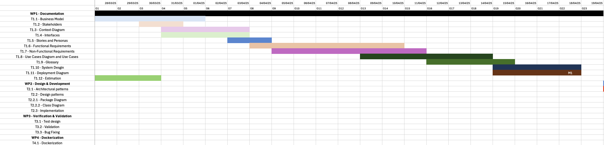
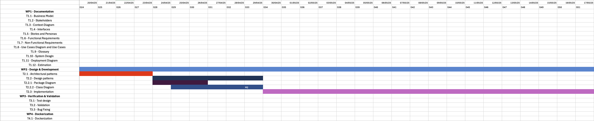
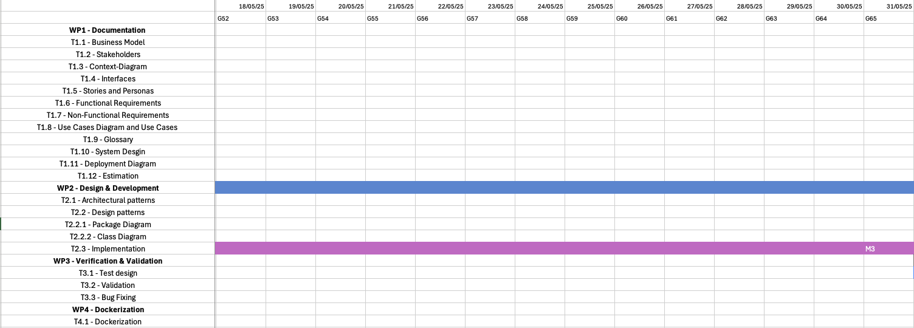
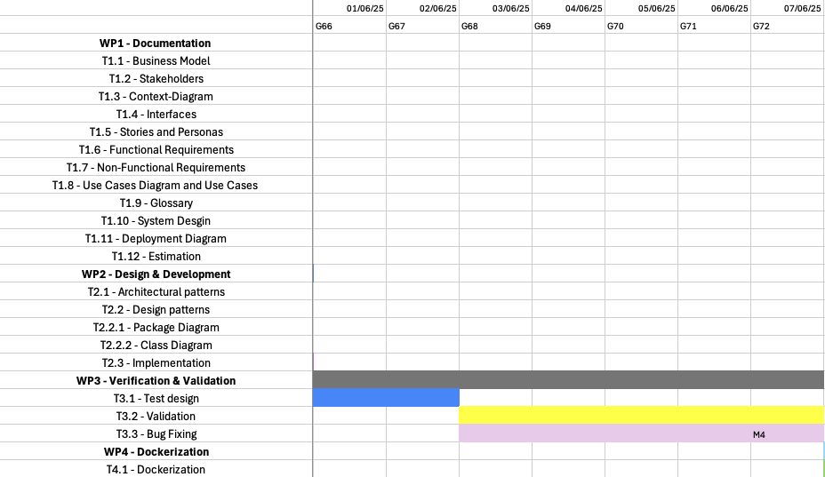
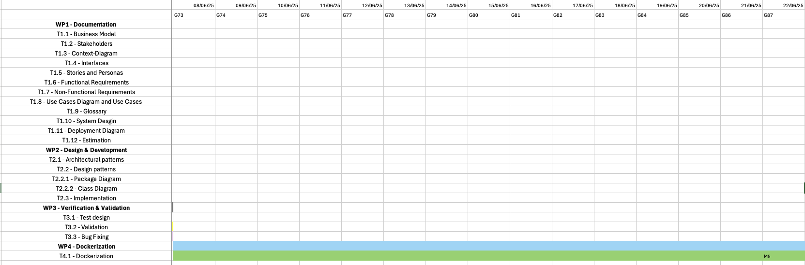

# Project Estimation

Date:

Version:

# Estimation approach

Consider the GeoControl project as described in the swagger, assume that you are going to develop the project INDEPENDENT of the deadlines of the course, and from scratch

# Estimate by size

###

|                                                                                                         | Estimate |
| ------------------------------------------------------------------------------------------------------- | -------- |
| NC = Estimated number of classes to be developed                                                        |     12     | 
| A = Estimated average size per class, in LOC                                                            |       350   |
| S = Estimated size of project, in LOC (= NC \* A)                                                       |    4200      |
| E = Estimated effort, in person hours (here use productivity 10 LOC per person hour)                    |     420     |
| C = Estimated cost, in euro (here use 1 person hour cost = 30 euro)                                     |     12.600     |
| Estimated calendar time, in calendar weeks (Assume team of 4 people, 8 hours per day, 5 days per week ) |     2,6     |

# Estimate by product decomposition

###

| component name       | Estimated effort (person hours) |
| -------------------- | ------------------------------- |
| requirement document |               50                |
| design document      |               40                |
| code                 |              420                |
| unit tests           |              50                 |
| api tests            |              50                 |
| management documents |              10                 |

# Estimate by activity decomposition

###

| Activity name | Estimated effort (person hours) |
| ------------- | ------------------------------- |
|               |                                 |

###

Insert here Gantt chart with above activities

### Milestones
M1: Requirements Document -> Dipendenze: T1.1 - T1.12\
M2: Design Document -> Dipendenze: T2.1 - T2.2\
M3: Development -> Dipendenze: T2.3\
M4: Validation & Verification -> Dipendenze: T3.1 - T3.3\
M5: Dockerization -> Dipendenze: T4.1

### Deliverables

D1.1 - Business Model Paragraph\
D1.2 - Stakeholders \
D1.3 - Context-Diagram\
D1.4 - Interfaces\
D1.5 - Stories and Personas Paragraph\
D1.6 - Functional Requirements\
D1.7 - Non-Functional Requirements\
D1.8 - Use Cases Diagram and Use Cases Paragraph\
D1.9 - Glossary\
D1.10 - System Design Diagram\
D1.11 - Deployment Diagram\
D1.12 - Estimation Document

D2.1 - Architectural patterns\
D2.2 - Design Document\
D2.2.1 - Package Diagram\
D2.2.2 - Class Diagram\
D2.3 - GeoControl Source Code

D3.1 - Test Design\
D3.2 - Validation Results\
D3.3 - Updated Source Code

D4.1 - Dockerized Project

# Summary

Report here the results of the three estimation approaches. The estimates may differ. Discuss here the possible reasons for the difference

|                                    | Estimated effort | Estimated duration |
| ---------------------------------- | ---------------- | ------------------ |
| estimate by size                   |        420       | 2,6 weeks
| estimate by product decomposition  |                  |
| estimate by activity decomposition |                  |
