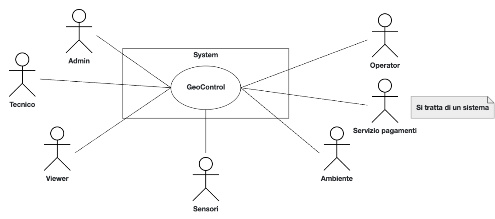
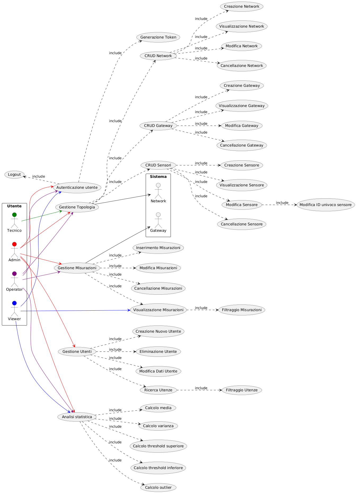
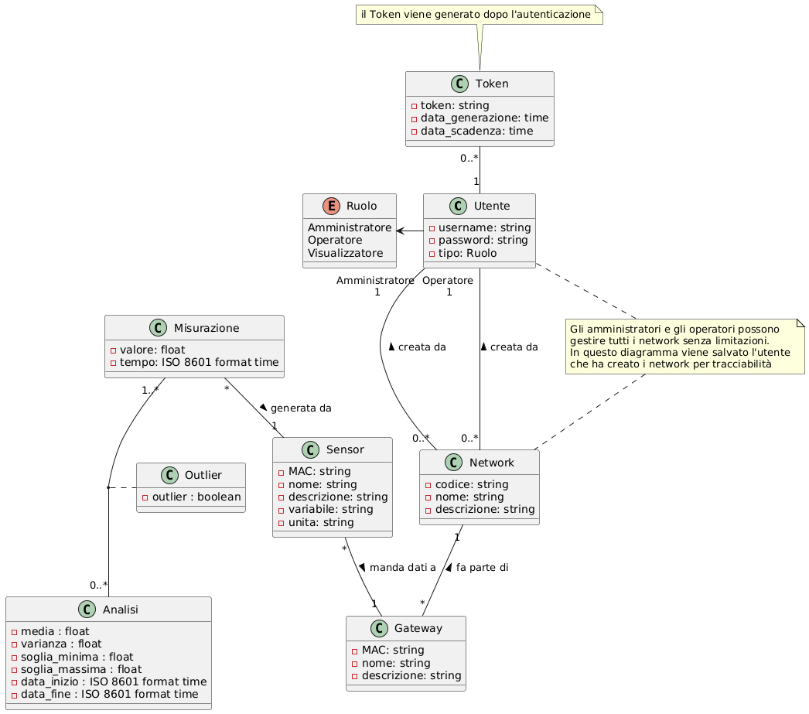
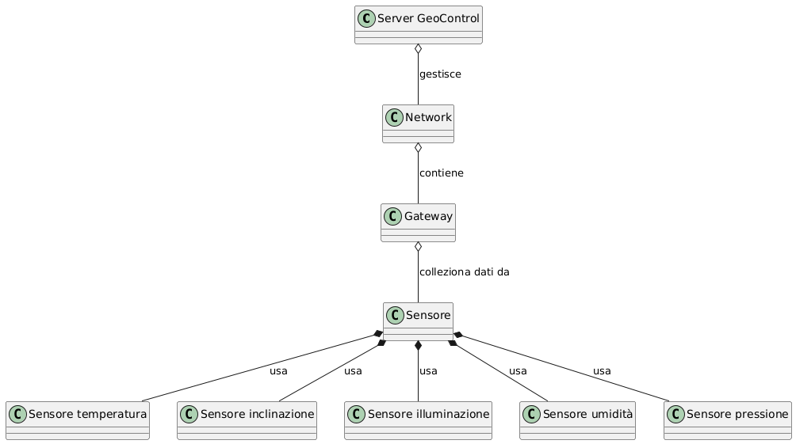
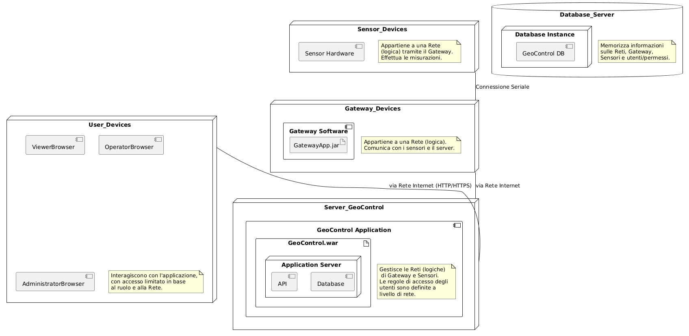

# Requirements Document - GeoControl

Date:

Version: V1 - description of Geocontrol as described in the swagger

| Version number | Change |
| :------------: | :----: |
|                |        |

# Contents

- [Requirements Document - GeoControl](#requirements-document---geocontrol)
- [Contents](#contents)
- [Informal description](#informal-description)
- [Business model](#business-model)
- [Stakeholders](#stakeholders)
- [Context Diagram and interfaces](#context-diagram-and-interfaces)
  - [Context Diagram](#context-diagram)
  - [Interfaces](#interfaces)
- [Stories and personas](#stories-and-personas)
- [Functional and non functional requirements](#functional-and-non-functional-requirements)
  - [Functional Requirements](#functional-requirements)
  - [Non Functional Requirements](#non-functional-requirements)
- [Use case diagram and use cases](#use-case-diagram-and-use-cases)
  - [Use case diagram](#use-case-diagram)
    - [Use case 1: Autenticazione Utente](#use-case-1-autenticazione-utente)
      - [Scenario 1.1](#scenario-11)
      - [Scenario 1.2](#scenario-12)

    - [Use case 2: Visualizzazione Misurazioni](#use-case-2-visualizzazione-misurazioni)
      - [Scenario 2.1](#scenario-21)
      - [Scenario 2.2](#scenario-22)
      - [Scenario 2.3](#scenario-23)
      - [Scenario 2.4](#scenario-24)

    - [Use case 3: Gestione Misurazioni](#use-case-3-gestione-misurazioni)
      - [Scenario 3.1](#scenario-31)
      - [Scenario 3.2](#scenario-32)

    - [Use case 4: Gestione Topologia](#use-case-4-gestione-topologia)
      - [Scenario 4.1](#scenario-41)
      - [Scenario 4.2](#scenario-42)
      - [Scenario 4.3](#scenario-43)
      - [Scenario 4.4](#scenario-44)

    - [Use case 5: Gestione Utenti](#use-case-5-gestione-utenti)
      - [Scenario 5.1](#scenario-51)
      - [Scenario 5.2](#scenario-52)

    - [Use case 6: Analisi Statistica](#use-case-6-analisi-statistica)
      - [Scenario 6.1](#scenario-61)
      - [Scenario 6.2](#scenario-62)
- [Glossary](#glossary)
- [System Design](#system-design)
- [Deployment Diagram](#deployment-diagram)

# Informal description

GeoControl is a software system designed for monitoring physical and environmental variables in various contexts: from hydrogeological analyses of mountain areas to the surveillance of historical buildings, and even the control of internal parameters (such as temperature or lighting) in residential or working environments.

# Business Model
L'azienda sviluppatrice viene incaricata di realizzare un sistema software (**GeoControl**) per il monitoraggio di parametri interni, quali temperatura e illuminazione, e l'analisi idrogeologica di aree montuose.
La realizzazione del software viene richiesta e finanziata parzialmente dall'unione delle comunità montane della regione Piemonte, ma prevede, a seguito di trattative con la comunità, di poter avere come **target di mercato** anche entità pubbliche o private che necessitano di monitoraggio costante per parametri come quelli sopra citati.\
La principale strategia di marketing è quella di generare **revenues** mediante la vendita di lincenze.\
Inzialmente sono previsti piani a pagamento aventi costo differente a seconda della durata della licenza, in particolare:

| Licenza |  Durata | Risparmio |
| :--------------: | :---------: | :---------: |
| Mensile  | 1 mese | 0%  |
| Annuale  | 12 mesi | 10% |

E' prevista la possibilità di avere un servizio aggiuntivo a pagamento per l'installazione e la configurazione del sistema mediante l'intervento di un tecnico. L'applicativo deve poter supportare sensori di tipo COTS reperibili sul mercato.
Inoltre, l'applicativo dovrà gestire i seguenti ruoli:

| User |  Funzionalità disponibili |
| :--------------: | :---------: |
| Viewer | operazione di sola lettura su dati, sensori e gateway|
| Operator |  inserimento manuale delle misurazioni, gestione dei dispositivi come sensori, gateways etc.|
| Admin | ha accesso a tutte le risorse, quindi può eseguire operazioni su utenti e reti |

Visto quindi la possibile diversità di utenti, bisognerà offrire un sistema di autenticazione con diverse interfacce.

Inoltre, GeoControl dovrà essere in grado di comunicare con dispositivi come sensori e gateways tramite Internet, utilizzando il protocollo HTTP. Questo permetterà al sistema di ricevere, gestire e analizzare i dati e i timestamps provenienti dalle misurazioni, effettuate con una frequenza di aggiornamento di 10 minuti, garantendo così un monitoraggio costante e in tempo reale delle variabili ambientali.\
Perciò le caratteristiche principali del software, che costituiscono un valore, saranno:
- capacità di gestione di grandi quantità di dati 
- scalabilità: possibilità di aggiungere quanti più dispositivi si desidera
- affidabilità: basso tasso di misurazioni incorrette in 1 anno
- facilità di utilizzo: è sufficiente inserire i dati dei propri sensori

# Stakeholders

| Stakeholder name | Description |
| :--------------: | :---------: |
| Unità delle comunità montane  |  Analisi del territorio e dei relativi parametri|
| Ambiente (Zone montuose e Edifici storici)| Mantenimento sotto controllo e in salute |
| Viewer | Possibilità di accesso a una grande quantità di misurazioni da poter consultare|
| Operator | Gestione e mantenimento di una grande quantità di misurazioni |
| Admin | Gestione degli utenti e delle reti |
| Servizio di pagamento | Gestione dei pagamenti delle licenze |
| Tecnico | Manutenzione/ Installazione / Configurazione dei sensori |

# Context Diagram and interfaces

## Context Diagram

## Interfaces

|   Actor   | Logical Interface | Physical Interface |
| :-------: | :---------------: | :----------------: |
| Servizio pagamenti |   API Paypal, BancaSella, IntesaSanpaolo, Unicredit     |       Connessione Internet          |
| Viewer |  GUI | PC |
| Operator | GUI | PC |
| Admin | GUI | PC |
| Tecnico | GUI | PC |
| Ambiente |  Temperatura e illuminazione e varie | Modulo di misurazione del sensore |
| Sensori | Variabili Fisiche e Ambientali | Connessione Seriale |

# Stories and personas

| ID Persona  | Sesso | Età | Occupazione | Conoscenza Tecnica | Conoscenza di Dominio |
| :-------: | :---------------: | :----------------: | :----------------: | :----------------: | :----------------: |
| 1 | M | Mezza età | Manager del Museo | Bassa | Alta |
| 2 | F | Giovane | Studente PhD | Alta | Alta |
| 3 | M | Mezza età | Tecnico | Alta | Media |
| 4 | F | Giovane | Fotografo | Media | Alta |
| 5 | M | Anziano | Pensionato | Bassa | Bassa |
| 6 | M | Giovane | Admin | Alta | Media |

- **Storia persona 1**: Ha bisogno di capire se è necessario investire in un nuovo sistema di regolazione della temperature e/o di illuminazione, necessita di dati molto precisi e affidabili per prendere una decisione.
- **Storia persona 2**: Sta effettuando un progetto di ricerca in collaborazione con un ente che si occupa del monitoraggio e depurazione della rete fognaria di una grande città. Ha bisogno di fare analisi su una grandi moli di dati relativi ad un ampio intervallo temporale.
- **Storia persona 3**: Deve installare il sistema GeoControl presso aziende/strutture/località montane. Deve aver la possibilità di interagire con il sistema temporaneamente con il ruolo di Admin e necessità di un sistema fortemente integrato.
- **Storia persona 4**: Ha uno studio fotografico e deve poter tenere sotto controllo il livello dell'illuminazione per poter offrire un servizio di qualità.
- **Storia persona 5**: L'Istituto Nazionale di Geofisica e Vulcanologia mette a disposizione i dati delle misurazioni dell'attività sismica di alcune zone d'Italia per gli utenti, attraverso il ruolo Viewer dell'applicativo. L'interfaccia deve essere estremamente user friendly, garantendo la fruizione di dati semplici e dettagliati.
- **Storia persona 6**: È l'admin di sistema di un'azienda privata che vuole tenere sotto controllo la temperatura dell'ambiente di lavoro. Deve poter gestire le reti e i ruoli del sistema in maniera intuitiva e affidabile.

# Functional and non functional requirements

## Functional Requirements

|  ID   | Description |
| :---: | :---------: |
|  FR1  | Autenticazione |
| <ul> FR1.1<ul> | <ul>Login (inserimento username e password)<ul> |
| <ul>FR1.2<ul> | <ul>Generazione del token di sessione<ul> |
| <ul>FR1.3<ul> | <ul>Logout<ul> |
| FR2   | CRUD utenze |
| <ul>FR2.1<ul> | Creazione e inserimento dell'utenza |
| <ul><ul>FR2.1.1<ul><ul> | <ul>Raccolta informazioni utente<ul> |
| <ul><ul>FR2.1.2<ul><ul> | <ul>Inserimento utenza con credenziali di default (admin)<ul> |
| <ul>FR2.2<ul> | <ul>Modifica dell'utenza<ul> |
| <ul><ul>FR2.2.1<ul><ul> | <ul>Modifica lato admin<ul> |
| <ul><ul>FR2.2.2<ul><ul> | <ul>Modifica lato utente (credenziali/informazioni)<ul> |
| <ul>FR2.3<ul> | <ul>Cancellazione dell'utenza<ul> |
| <ul>FR2.4<ul> | <ul>Ricerca utenze<ul> |
| <ul><ul>FR2.4.1<ul><ul> | <ul>Operazioni di filtraggio delle utenze<ul>|
| FR3 | CRUD misurazioni |
| <ul>FR3.1<ul> | <ul>Creazione e inserimento delle misurazioni<ul> |
| <ul><ul>FR3.1.1<ul><ul> | <ul>Conversione timezone del timestamp della misurazione<ul> |
| <ul><ul> FR3.1.2<ul><ul> | <ul>Inserimento e associazione delle misurazioni ricevute<ul> |
| <ul><ul>FR3.1.3<ul><ul> | <ul>Inserimento misurazioni lato operator/admin<ul> |
| <ul>FR3.2<ul> | <ul>Modifica delle misurazioni<ul> |
| <ul>FR3.3<ul> | <ul>Cancellazione delle misurazioni<ul> |
| <ul>FR3.4<ul> | <ul>Navigazione e ricerca delle misurazioni<ul> |
| <ul><ul>FR3.4.1<ul><ul> | <ul>Operazioni di filtraggio delle misurazioni<ul> |
| FR4   | Gestione della topologia |
| <ul>FR4.1<ul> | <ul>CRUD Networks<ul> |
| <ul><ul>FR4.1.1<ul><ul> | <ul>Inserimento nuovi dispositivi<ul> |
| <ul><ul>FR4.1.2<ul><ul> | <ul>Generazione ID univoco secondo specifiche<ul> |
| <ul><ul>FR4.1.3<ul><ul> | <ul>Modifica della topologia<ul> |
| <ul><ul>FR4.1.4<ul><ul> | <ul>Rimozione dispositivi<ul> |
| <ul><ul>FR4.1.5<ul><ul> | <ul>Navigazione dei dispositivi<ul> |
| <ul>FR4.2<ul> | <ul>CRUD Gateways<ul> |
| <ul><ul>FR4.2.1<ul><ul> | <ul>Inserimento nuovi dispositivi<ul> |
| <ul><ul>FR4.2.2<ul><ul> | <ul>Generazione ID univoco secondo specifiche<ul> |
| <ul><ul>FR4.2.3<ul><ul> | <ul>Modifica della topologia<ul> |
| <ul><ul>FR4.2.4<ul><ul> | <ul>Rimozione dispositivi<ul> |
| <ul><ul>FR4.2.5<ul><ul> | <ul>Navigazione dei dispositivi<ul> |
| <ul>FR4.3<ul> | <ul>CRUD Sensori<ul> |
| <ul><ul>FR4.3.1<ul><ul> | <ul>Inserimento nuovi dispositivi<ul> |
| <ul><ul>FR4.3.2<ul><ul> | <ul>Generazione ID univoco secondo specifiche<ul> |
| <ul><ul>FR4.3.3<ul><ul> | <ul>Modifica della topologia<ul> |
| <ul><ul>FR4.3.4<ul><ul> | <ul>Rimozione dispositivi<ul> |
| <ul><ul>FR4.3.5<ul><ul> | <ul>Navigazione dei dispositivi<ul> |
| FR5   | Operazioni di calcolo e analisi statistica |
| <ul>FR5.1<ul>  | <ul>Calcolo media<ul> |
| <ul>FR5.2<ul>  | <ul>Calcolo varianza<ul> |
| <ul>FR5.3<ul>  | <ul>Calcolo Threshold superirore<ul> |
| <ul>FR5.4<ul>  | <ul>Calcolo Threshold inferiore<ul> |
| <ul>FR5.5<ul>  | <ul>Flagging outliers<ul> |
| FR6   | Gestione Pagamenti |
| <ul>FR6.1<ul>   | <ul>Richiesta pagamento<ul> |
| <ul>FR6.2<ul>   | <ul>Gestione  dati di pagamento<ul> |
| FR7 | Verifica Licenza |

## Non Functional Requirements
|   ID    | Type (efficiency, reliability, ..) | Description | Refers to |
| :-----: | :--------------------------------: | :---------: | :-------: |
|  NFR1   |      Efficienza                    | Le misurazioni devono essere realizzate ogni 10 minuti | FR3.1.2 |
|  NFR2   |      Privacy                       | I dati devono essere trattati in accordo con le normative del GDPR | FR2 |
|  NFR3   |      Dominio                       | Il timestamp delle misurazioni devono essere convertite secondo il formato ISO8601 | FR3.1.1 |
|  NFR4   |      Affidabilità                  | Non più di 6 misurazioni all'anno, per sensore, devono essere perse | FR3 |
|  NFR5  |      Sicurezza                     | Il sistema deve impedire agli utenti di eseguire operazioni per le quali non sono autorizzati e deve impedire accessi malevoli| FR1, FR2 |
|  NFR5   |      Dominio                       | Il timestamp delle misurazioni devono essere convertite secondo il formato ISO8601 | FR3.1.1 |
|  NFR6 |       Usabilità                    |     /   | Tutti |
|  NFR6.1 |       Usabilità                    |    L'utente di tipo Viewer non deve aver bisogno di training per utilizzare il software    |  |
|  NFR6.2 |       Usabilità                    |    Gli utenti di tipo Operator e Amministratore devono aver bisogno di un training di al massimo 2 ore    |  |
| NFR7 | Portabilità | Il software dev'essere accessibile su diversi sistemi operativi   • Windows   •Linux  • MacOS  | Tutti |
| NFR8 | Efficienza |  Ogni utente deve individuare non più di 5 bug all'anno | Tutti |
| NFR9 | Dominio | Le misurazioni devono essere espresse utilizzando le unità di misura previste dal SISTEMA INTERNAZIONALE DELLE UNITA' DI MISURA | Tutti |

# Use case diagram and use cases

## Use case diagram

### Use case 1: Autenticazione Utente

| Actors Involved  |                              Utente (Operator,  Admin)                                        |
| :--------------: | :------------------------------------------------------------------: |
|   Precondition   | Il sistema GeoControl è attivo e accessibile. L'utente possiede credenziali valide. |
|  Post condition  |  L'utente è autenticato e un token di autenticazione è stato generato e fornito.   |
| Nominal Scenario |         1. L'utente inserisce username e password. 2. Il sistema verifica le credenziali. 3. Il sistema genera un token di autenticazione. 4. Il sistema restituisce il token all'utente.         |
|     Variants     |                      Nessuno specificato al momento.                      |
|    Exceptions    |                        E1: Credenziali Invalide. E2: Errore interno del sistema durante l'autenticazione.                        |

#### Scenario 1.1

Autenticazione Utente con Successo

|  Scenario 1.1  |                                                                            |
| :------------: | :------------------------------------------------------------------------: |
|  Precondition  | Il sistema GeoControl è attivo e accessibile. L'utente possiede credenziali valide. |
| Post condition |    L'utente è autenticato e un token di autenticazione valido è stato generato e fornito.   |
|     Step#      |                                Descrizione                                 |
|       1        |   L'utente naviga alla pagina di login.                                                                         |
|       2        |   L'utente inserisce il proprio username nel campo dedicato.                                                                         |
|      3       |    L'utente inserisce la propria password nel campo dedicato.                                                                        |
|      4       |             L'utente clicca sul pulsante "Accedi".                                                               |
|    5       |       Il sistema riceve le credenziali.                                                                     |
|      6       |        Il sistema confronta le credenziali inserite con quelle memorizzate nel database.                                                                    |
|      7       |    	Le credenziali corrispondono.                                                                        |
|      8       |     Il sistema genera un token di autenticazione univoco.                                                                       |    
|      9       |     Il sistema memorizza il token associato all'utente e alla sessione (se necessario).                                                                       | 
|      10       |     Il sistema restituisce il token all'applicazione client dell'utente.| 
|      11      |     L'utente viene reindirizzato alla pagina principale o all'area riservata.                                                                      | 

#### Scenario 1.2

Tentativo di Autenticazione con Credenziali Invalide

|  Scenario 1.2  |                                                                            |
| :------------: | :------------------------------------------------------------------------: |
|  Precondition  | Il sistema GeoControl è attivo e accessibile. L'utente possiede credenziali non valide o le inserisce in modo errato. |
| Post condition |  L'utente non è autenticato. Viene visualizzato un messaggio di errore.   |
|     Step#      |                                Descrizione                                 |
|       1        |    L'utente naviga alla pagina di login.                                                                        |
|       2        |      L'utente inserisce un username non valido o inesistente.                                                                      |
|      3       |       L'utente inserisce una password errata.                                                                     |
|      4       |       L'utente clicca sul pulsante "Accedi". errata.                                                                     |
|      5       |      Il sistema riceve le credenziali.errata.                                                                     |
|      6       |      Il sistema confronta le credenziali inserite con quelle memorizzate nel database.errata.                                                                     |
|      7       |       Le credenziali non corrispondono. errata.                                                                     |
|      8       |       Il sistema visualizza un messaggio di errore all'utente (es. "Username o password errati").errata.                                                                     |
|      9       |       L'utente rimane sulla pagina di login e può tentare nuovamente l'accesso. errata.                                                                     |

### Use case 2: Visualizzazione Misurazioni

| Actors Involved  |            Utente(Admin, Operator,Visualizzatore)                                                         |
| :--------------: | :------------------------------------------------------------------: |
|   Precondition   | L'utente è autenticato e possiede un token valido. Sono presenti dati di monitoraggio nel sistema. |
|  Post condition  |  I dati di monitoraggio selezionati vengono visualizzati all'utente.   |
| Nominal Scenario |         1. L'utente seleziona una rete, un gateway o un sensore. 2. Il sistema recupera le misurazioni associate. 3. Il sistema visualizza i dati.         |
|     Variants     |          V1: Visualizzazione in formato tabellare. V2: Visualizzazione in formato grafico.                      |
|    Exceptions    |         E1: Nessun dato disponibile per la selezione. E2: Errore durante il recupero dei dati dal database.                       |

#### Scenario 2.1

Visualizzazione Dati di un Sensore Specifico in Formato Tabellare

|  Scenario 2.1  |                                                                            |
| :------------: | :------------------------------------------------------------------------: |
|  Precondition  | L'utente è autenticato e possiede un token valido. Sono presenti misurazioni per il sensore selezionato. |
| Post condition |  Le misurazioni del sensore selezionato vengono visualizzate in una tabella con timestamp e valori.   |
|     Step#      |                                Descrizione                                 |
|       1        |  L'utente naviga alla sezione di visualizzazione dati.                                                                          |
|       2        |     	L'utente seleziona un sensore specifico da un elenco o tramite una mappa.                                                                       |
|      3       |      L'utente seleziona l'opzione di visualizzazione "Tabella".                                                                      |
|      4       |         Il sistema riceve la richiesta del sensore.                                                                   |
|      5       |       Il sistema interroga il database per recuperare tutte le misurazioni associate a quel sensore.                                                                     |
|      6       |     Il database restituisce le misurazioni trovate.                                                                       |
|      7       |     Il sistema formatta i dati in una tabella con colonne per timestamp e valore della misurazione.                                                                       |
|      8       |    	Il sistema visualizza la tabella all'utente.                                                                        |

#### Scenario 2.2
Nessun Dato Disponibile per il Sensore Selezionato

|  Scenario 2.2  |                                                                            |
| :------------: | :------------------------------------------------------------------------: |
|  Precondition  | L'utente è autenticato e possiede un token valido. Non sono presenti misurazioni per il sensore selezionato. |
| Post condition |  Viene visualizzato un messaggio indicante l'assenza di dati.   |
|     Step#      |                                Descrizione                                 |
|       1        |      L'utente naviga alla sezione di visualizzazione dati.                                                                      |
|       2        |         	L'utente seleziona un sensore specifico da un elenco o tramite una mappa.                                                                   |
|      3       |           Il sistema riceve la richiesta del sensore.                                                                 |
|      4       |               Il sistema interroga il database per recuperare le misurazioni associate a quel sensore.                                                             |
|      5       |               Il database non trova misurazioni per quel sensore.                                                            |
|      6       |                      Il sistema visualizza un messaggio all'utente (es. "Nessun dato di monitoraggio disponibile per il sensore selezionato.").                                                      |
     
#### Scenario 2.3

Filtraggio e Visualizzazione Tabellare delle Misurazioni in un Intervallo Valido

|  Scenario 2.3  |                                                                            |
| :------------: | :------------------------------------------------------------------------: |
|  Precondition  | L'utente è autenticato. Sono presenti misurazioni per il sensore selezionato all'interno dell'intervallo specificato. |
| Post condition |  Le misurazioni del sensore che rientrano nell'intervallo di tempo sono visualizzate in formato tabellare.  |
|     Step#      |                                Descrizione                                 |
|       1        |     L'utente naviga alla sezione di visualizzazione dati e seleziona un sensore.                                                                       |
|       2        |       L'utente individua e seleziona l'opzione "Filtra per Intervallo di Tempo".                                                                     |
|      3       |        Vengono mostrati i campi per inserire la data e l'ora di inizio. L'utente li compila.                                                                    |
|      4       |          Vengono mostrati i campi per inserire la data e l'ora di fine. L'utente li compila, assicurandosi che la data di fine sia successiva o uguale alla data di inizio.                                                                  |
|      5       |        L'utente clicca sul pulsante "Applica Filtro" o "Cerca".                                                                    |
|      6       |             Il sistema riceve i parametri del filtro (ID sensore, data/ora inizio, data/ora fine).                                                               |
|      7       |           Il sistema interroga il database selezionando le misurazioni del sensore specificato con timestamp compresi tra l'inizio e la fine dell'intervallo.                                                                 |
|      8       |           Il database restituisce le misurazioni trovate.                                                                 |
|      9       |           Il sistema formatta le misurazioni in una tabella (timestamp, valore).                                                                 |
|      10       |            	Il sistema visualizza la tabella all'utente.                                                                |

#### Scenario 2.4

Inserimento di un Intervallo di Tempo Non Valido 

|  Scenario 2.4  |                                                                            |
| :------------: | :------------------------------------------------------------------------: |
|  Precondition  | L'utente è autenticato e sta tentando di filtrare le misurazioni. |
| Post condition |  Viene visualizzato un messaggio di errore che indica che l'intervallo di tempo non è valido. La ricerca non viene eseguita con parametri errati. |
|     Step#      |                                Descrizione                                 |
|       1        |   L'utente naviga alla sezione di visualizzazione dati e seleziona un sensore.                                                            |
|       2        |       L'utente seleziona l'opzione "Filtra per Intervallo di Tempo".                                                                    |
|      3       |       L'utente inserisce una data e un'ora di inizio.                                                             |
|      4       |         L'utente inserisce una data e un'ora di fine che è precedente alla data e ora di inizio.                                            |
|      5       |       L'utente clicca sul pulsante "Applica Filtro" o "Cerca".                                                                 |
|      6       |           Il sistema verifica la validità dell'intervallo (data/ora inizio <= data/ora fine).                                      |
|      7       |         Il sistema rileva che la data di fine è precedente alla data di inizio.                                                          |
|      8       |          Il sistema visualizza un messaggio di errore all'utente (es. "L'intervallo di tempo inserito non è valido. La data di fine deve essere successiva o uguale alla data di inizio.").                                             |
|      9       |         	Il sistema non esegue la ricerca con l'intervallo non valido e permette all'utente di correggere gli input.                                                     |

### Use case 3: Gestione Misurazioni

| Actors Involved  |             Sistema (Gateway), Utente(Admin, Operator)                                                     |
| :--------------: | :------------------------------------------------------------------: |
|   Precondition   | Il sistema GeoControl è attivo. Per l'inserimento via Gateway: il Gateway è configurato correttamente e connesso. Per l'inserimento manuale: l'Admin è autenticato. |
|  Post condition  | 	La nuova misurazione è stata memorizzata nel database ed è associata al sensore corretto. Il timestamp è in formato ISO8601.  |
| Nominal Scenario |        1a. (Via Gateway) Il Gateway invia una misurazione. 1b. (Manuale) L'Admin inserisce i dati della misurazione. 2. Il sistema valida i dati. 3. Il sistema converte il timestamp in ISO8601. 4. Il sistema associa e memorizza la misurazione.         |
|     Variants     |          	Nessuno specificato al momento.                    |
|    Exceptions    |      E1: Errore di validazione dei dati. E2: Errore durante la conversione del timestamp. E3: Errore durante la memorizzazione nel database.    |

#### Scenario 3.1

Ricezione e Inserimento di una Misurazione Valida da Gateway

|  Scenario 3.1  |                                                                            |
| :------------: | :------------------------------------------------------------------------: |
|  Precondition  | Il sistema GeoControl è attivo. Il Gateway è configurato correttamente e connesso. La misurazione inviata è in un formato valido. |
| Post condition |  La misurazione ricevuta è stata validata, il timestamp convertito in ISO8601 e memorizzata nel database associata al sensore corretto.   |
|     Step#      |                                Descrizione                                 |
|       1        |     Il Gateway rileva un valore dal sensore.                                                                       |
|       2        |          Il Gateway formatta i dati della misurazione (valore, timestamp, ID sensore).                                                                  |
|      3       |       Il Gateway invia i dati della misurazione al sistema GeoControl (tramite API di ingestione).                                                                     |
|      4       |      	Il sistema riceve i dati della misurazione.                                                                      |
|      5       |          Il sistema valida il formato dei dati ricevuti (es. presenza di tutti i campi necessari, tipi di dati corretti).                                                                  |
|      6       |        Il sistema estrae il timestamp originale.                                                                    |
|      7       |           Il sistema converte il timestamp nel formato ISO8601.                                                                 |
|      8       |           	Il sistema identifica il sensore associato tramite l'ID fornito.                                                                 |
|      9       |             	Il sistema memorizza la misurazione (valore e timestamp convertito) nel database, collegandola al sensore identificato.                                                               |
|      10       |          Il sistema (opzionalmente) invia una conferma di ricezione al Gateway.                                                                  |

#### Scenario 3.2

Inserimento Manuale di una Misurazione Valida da Parte dell'Admin

|  Scenario 3.2  |                                                                            |
| :------------: | :------------------------------------------------------------------------: |
|  Precondition  | Il sistema GeoControl è attivo. L'Admin è autenticato e ha accesso alla funzionalità di inserimento manuale. |
| Post condition |  La misurazione inserita è stata validata, il timestamp convertito in ISO8601 e memorizzata nel database associata al sensore selezionato.   |
|     Step#      |                                Descrizione                                 |
|       1        |      L'Admin naviga alla sezione di inserimento manuale misurazioni.                                                                      |
|       2        |        L'Admin seleziona un sensore dalla lista.                                                                    |
|      3       |          L'Admin inserisce il valore della misurazione.                                                                  |
|      4       |             L'Admin inserisce il timestamp della misurazione.                                                               |
|      5       |           L'Admin clicca sul pulsante "Salva".                                                                 |
|      6       |                   	Il sistema riceve i dati inseriti.                                                         |
|      7       |                  Il sistema valida il formato dei dati inseriti (es. tipo di dato del valore).                                                          |
|      8       |               Il sistema converte il timestamp inserito nel formato ISO8601.                                                             |
|      9       |                	Il sistema memorizza la misurazione (valore e timestamp convertito) nel database, collegandola al sensore selezionato.                                                            |
|      10       |          Il sistema visualizza un messaggio di conferma dell'inserimento.                                                                  |

### Use case 4: Gestione Topologia

| Actors Involved  |             Sistema(Network), Utente(Admin, Operator, Tecnico)                                                         |
| :--------------: | :------------------------------------------------------------------: |
|   Precondition   | L'Admin è autenticato e ha accesso alle funzionalità di gestione della topologia. |
|  Post condition  |  La topologia del sistema (reti, gateway, sensori) è stata modificata come richiesto. Gli ID univoci sono generati secondo le specifiche.   |
| Nominal Scenario |       1. L'Admin seleziona l'operazione desiderata (inserimento, modifica, rimozione). 2. L'Admin fornisce i dati necessari. 3. Il sistema valida i dati. 4. Il sistema esegue l'operazione e (se necessario) genera un ID univoco. 5. Il sistema aggiorna la topologia.        |
|     Variants     |          V1: Inserimento di una nuova rete. V2: Inserimento di un nuovo gateway. V3: Inserimento di un nuovo sensore. V4: Modifica di un dispositivo esistente. V5: Rimozione di un dispositivo.                     |
|    Exceptions    |        E1: Errore di validazione dei dati inseriti. E2: Tentativo di inserire un ID univoco già esistente. E3: Errore durante l'aggiornamento del database. E4: Tentativo di rimuovere un dispositivo con dipendenze attive.                |

#### Scenario 4.1

Inserimento di un Nuovo Sensore

|  Scenario 4.1  |                                                                            |
| :------------: | :------------------------------------------------------------------------: |
|  Precondition  | L'Admin è autenticato e ha accesso alla funzionalità di gestione della topologia. Esiste almeno un gateway nel sistema a cui poter associare il sensore. |
| Post condition |  Un nuovo sensore è stato registrato nel sistema con un ID univoco generato secondo le specifiche ed è associato al gateway selezionato.   |
|     Step#      |                                Descrizione                                 |
|       1        |   	L'Admin naviga alla sezione di gestione della topologia e seleziona "Aggiungi Nuovo Sensore".                                                                         |
|       2        |      	L'Admin inserisce i dettagli del sensore: nome descrittivo, tipo di sensore.                                                                      |
|      3       |       L'Admin seleziona il gateway a cui associare il sensore da un elenco.                                                                     |
|      4       |        Il sistema genera un ID univoco per il nuovo sensore secondo le specifiche (FR4.1.1).                                                                    |
|      5       |       Il sistema convalida i dati inseriti (es. che il gateway selezionato esista).                                                                     |
|      6       |         	Il sistema memorizza le informazioni del nuovo sensore (ID univoco, nome, tipo, gateway associato) nel database.                                                                   |
|      7       |         Il sistema visualizza un messaggio di conferma dell'inserimento, mostrando l'ID univoco generato.                                                                   |

#### Scenario 4.2

Tentativo di Inserire un Sensore con un ID Univoco Già Esistente (se permesso l'inserimento manuale dell'ID)

|  Scenario 4.2  |                                                                            |
| :------------: | :------------------------------------------------------------------------: |
|  Precondition  | L'Admin è autenticato e ha accesso alla funzionalità di gestione della topologia. |
| Post condition |  L'inserimento del sensore fallisce e viene visualizzato un messaggio di errore.   |
|     Step#      |                                Descrizione                                 |
|       1        |       L'Admin naviga alla sezione di gestione della topologia e seleziona "Aggiungi Nuovo Sensore".                                                                     |
|       2        |       L'Admin inserisce i dettagli del sensore, incluso un ID univoco che è già presente nel sistema.                                                                     |
|      3       |          	L'Admin seleziona il gateway a cui associare il sensore.                                                                  |
|      4       |             	L'Admin clicca su "Salva".                                                               |
|      5       |           Il sistema verifica se l'ID univoco inserito è già presente nel database.                                                                 |
|      6       |              	L'ID univoco risulta già esistente.                                                              |
|      7       |               Il sistema visualizza un messaggio di errore (es. "L'ID univoco specificato è già in uso. Si prega di inserirne uno diverso o lasciare che il sistema ne generi uno automaticamente.").                                                             |
|      8       |           	Il sistema non memorizza le informazioni del nuovo sensore.                                                                 |

#### Scenario 4.3

Modifica del Nome Descrittivo di un Sensore

|  Scenario 4.3  |                                                                            |
| :------------: | :------------------------------------------------------------------------: |
|  Precondition  | L'Admin è autenticato e ha accesso alla gestione della topologia. Il sensore da modificare esiste. |
| Post condition |  Il nome descrittivo del sensore è stato aggiornato nel sistema.  |
|     Step#      |                                Descrizione                                |
|       1        |        L'Admin naviga alla sezione di gestione della topologia e seleziona "Modifica Dispositivo".                                                                    |
|       2        |           L'Admin seleziona il sensore desiderato da un elenco.                                                                 |
|      3       |            	Il sistema visualizza i dettagli del sensore (ID, nome attuale, tipo, gateway associato, ecc.).                                                                |
|      4       |          L'Admin modifica il valore del campo "Nome Descrittivo".                                                                  |
|      5       |             L'Admin clicca sul pulsante "Salva Modifiche" o simile.                                                               |
|      6       |              Il sistema convalida che il nuovo nome non sia vuoto (se richiesto).                                                              |
|      7       |              Il sistema aggiorna il campo "Nome" del sensore nel database.                                                              |
|      8       |               Il sistema visualizza un messaggio di conferma (es. "Sensore aggiornato con successo.").                                                             |

#### Scenario 4.4

Tentativo di Modificare l'ID Univoco di un Sensore

|  Scenario 4.4  |                                                                            |
| :------------: | :------------------------------------------------------------------------: |
|  Precondition  | L'Admin è autenticato e ha accesso alla gestione della topologia. Il sensore da modificare esiste. L'ID univoco del sensore non è modificabile. |
| Post condition | L'ID univoco del sensore rimane invariato. Viene visualizzato un messaggio di errore.  |
|     Step#      |                                Descrizione                                 |
|       1        |      L'Admin naviga alla sezione di gestione della topologia e seleziona "Modifica Dispositivo".                                                                      |
|       2        |        L'Admin seleziona il sensore desiderato da un elenco.                                                                    |
|      3       |       Il sistema visualizza i dettagli del sensore, incluso l'ID univoco (che appare non editabile o disabilitato).                                                                     |
|      4       |          L'Admin (ipoteticamente tenta di) modificare il valore del campo "ID Univoco".                                                                  |
|      5       |         Il sistema impedisce la modifica del campo "ID Univoco".                                                                   |
|      6       |              Il sistema visualizza un messaggio (es. "L'ID univoco del sensore non può essere modificato.").                                                              |
|      7       |             L'Admin prende atto del messaggio.                                                                             |

### Use case 5: Gestione Utenti

| Actors Involved  |             Utente(Admin)                                                         |
| :--------------: | :------------------------------------------------------------------: |
|   Precondition   | L'Admin è autenticato e ha accesso alle funzionalità di gestione dei ruoli utente. |
|  Post condition  |  I ruoli utente e i relativi permessi sono stati creati, modificati o visualizzati come richiesto.   |
| Nominal Scenario |     1. L'Admin accede alla gestione dei ruoli. 2. L'Admin seleziona l'operazione (crea, modifica, visualizza). 3. L'Admin fornisce i dati necessari (nome ruolo, permessi). 4. Il sistema convalida i dati. 5. Il sistema esegue l'operazione e aggiorna il sistema. 6. Il sistema fornisce un feedback all'Admin.       |
|     Variants     |       V1: Creazione di un nuovo ruolo. V2: Modifica dei permessi di un ruolo esistente. V3: Visualizzazione dei dettagli di un ruolo.             |
|    Exceptions    |     E1: Inserimento di un nome ruolo già esistente (durante la creazione). E2: Tentativo di modificare un ruolo di sistema protetto. E3: Errore durante l'aggiornamento del database dei ruoli e permessi.              |

#### Scenario 5.1

Inserimento di un Nuovo Sensore
Creazione di un Nuovo Ruolo Utente con Permessi Specifici

|  Scenario 5.1  |                                                                            |
| :------------: | :------------------------------------------------------------------------: |
|  Precondition  | L'Admin è autenticato e ha accesso alla gestione dei ruoli. Il nome "Tecnico di Campo" non esiste ancora nel sistema. |
| Post condition |  Un nuovo ruolo utente denominato "Tecnico di Campo" è stato creato con i permessi selezionati.   |
|     Step#      |                                Descrizione                                 |
|       1        |   	L'Admin naviga alla sezione di gestione dei ruoli utente.                                                                   |
|       2        |     L'Admin seleziona l'opzione "Crea Nuovo Ruolo".                                                              |
|      3       |       L'Admin seleziona il gateway a cui associare il sensore da un elenco.                                                                     |
|      4       |       Viene visualizzata una lista di permessi disponibili (es. "Visualizza Dati", "Inserisci Misurazioni Limitate"). L'Admin seleziona i permessi desiderati.                                     |
|      5       |     L'Admin clicca sul pulsante "Salva Ruolo".                                                          |
|      6       |       	Il sistema verifica che il nome del ruolo non sia già presente.                                                              |
|      7       |    Il sistema memorizza il nuovo ruolo e i permessi associati nel database.                                                          |
|      8       |    Il sistema visualizza un messaggio di conferma (es. "Ruolo 'Tecnico di Campo' creato con successo.").                                                    |

#### Scenario 5.2

 Tentativo di Modificare i Permessi del Ruolo "Admin" 

|  Scenario 5.2  |                                                                            |
| :------------: | :------------------------------------------------------------------------: |
|  Precondition  | L'Admin è autenticato e ha accesso alla gestione dei ruoli. Il ruolo "Admin" è un ruolo di sistema protetto. |
| Post condition | I permessi del ruolo "Admin" rimangono invariati. Viene visualizzato un messaggio di errore.   |
|     Step#      |                                Descrizione                                 |
|       1        |     L'Admin naviga alla sezione di gestione dei ruoli utente.|
|       2        |    	L'Admin seleziona il ruolo "Admin" dalla lista dei ruoli esistenti per visualizzarne o modificarne i permessi.                                                   |
|      3       |          	Il sistema visualizza i permessi correnti del ruolo "Admin".                                               |
|      4       |           L'Admin tenta di deselezionare o aggiungere un permesso al ruolo "Admin" e clicca su "Salva Modifiche".                                          |
|      5       |           Il sistema verifica se il ruolo selezionato è un ruolo di sistema protetto.                                               |
|      6       |        Il sistema identifica "Admin" come ruolo protetto.                                               |
|      7       |         Il sistema impedisce la modifica dei permessi per questo ruolo e visualizza un messaggio di errore (es. "Il ruolo 'Admin' non può essere modificato.").                                                             |

### Use case 6: Analisi Statistica

| Actors Involved  |             Utente (Operator, Admin, Viewer)                                                       |
| :--------------: | :------------------------------------------------------------------: |
|   Precondition   |L'utente è autenticato e ha accesso ai dati di monitoraggio. Sono presenti misurazioni nel sistema per i sensori selezionati. |
|  Post condition  |  Vengono visualizzati i risultati dei calcoli statistici (media, varianza, soglie, outlier) per le misurazioni selezionate.   |
| Nominal Scenario |    1. L'utente seleziona un sensore o un insieme di sensori e un intervallo di tempo. 2. L'utente seleziona il tipo di calcolo statistico da eseguire (media, varianza, soglie, outlier). 3. Il sistema recupera le misurazioni pertinenti. 4. Il sistema esegue i calcoli statistici. 5. Il sistema visualizza i risultati.   |
|     Variants     |    V1: Calcolo della media. V2: Calcolo della varianza. V3: Calcolo delle soglie (superiore e inferiore). V4: Identificazione degli outlier.     |
|    Exceptions    |    	E1: Nessun dato disponibile per i sensori e l'intervallo selezionati. E2: Intervallo di tempo non valido. E3: Errore durante l'esecuzione dei calcoli.            |

#### Scenario 6.1

 Calcolo della Media delle Misurazioni di un Sensore in un Intervallo di Tempo

|  Scenario 6.1  |                                                                            |
| :------------: | :------------------------------------------------------------------------: |
|  Precondition  | L'utente è autenticato e ha accesso ai dati. Sono presenti misurazioni per il sensore selezionato nell'intervallo specificato. |
| Post condition | Viene visualizzato il valore medio delle misurazioni del sensore per l'intervallo di tempo selezionato.  |
|     Step#      |                                Descrizione                                 |
|       1        |   	L'utente naviga alla sezione di analisi statistica o seleziona un'opzione per eseguire calcoli sui dati di un sensore.                                                         |
|       2        |    L'utente seleziona il sensore desiderato.                                              |
|      3       |     L'utente specifica l'intervallo di tempo per il quale calcolare la media (data/ora inizio e data/ora fine).                                                 |
|      4       |     	L'utente seleziona l'operazione "Calcola Media".                               |
|      5       |   Il sistema recupera tutte le misurazioni del sensore selezionato che rientrano nell'intervallo di tempo specificato.                                         |
|      6       |     Il sistema calcola la media dei valori delle misurazioni recuperate.                                                   |
|      7       |  	Il sistema visualizza il risultato (il valore medio) all'utente.                                               |

#### Scenario 6.2

 Identificazione degli Outlier per un Sensore in un Intervallo di Tempo

|  Scenario 6.2  |                                                                            |
| :------------: | :------------------------------------------------------------------------: |
|  Precondition  | L'utente è autenticato e ha accesso ai dati. Sono presenti misurazioni per il sensore selezionato nell'intervallo di tempo specificato. Il sistema ha implementate le funzioni per calcolare media e deviazione standard.|
| Post condition |Viene visualizzato l'elenco dei valori identificati come outlier per il sensore selezionato nell'intervallo di tempo specificato, insieme ai valori delle soglie utilizzate.  |
|     Step#      |                                Descrizione                                 |
|       1        |    L'utente naviga alla sezione di analisi statistica o seleziona un'opzione per eseguire calcoli sui dati di un sensore.      |
|       2        |    L'utente seleziona il sensore desiderato.                                                  |
|      3       |      L'utente specifica l'intervallo di tempo per il quale identificare gli outlier (data/ora inizio e data/ora fine).                                          |
|      4       |       L'utente seleziona l'operazione "Identifica Outlier" o simile.                    |
|      5       |        Il sistema recupera tutte le misurazioni del sensore selezionato che rientrano nell'intervallo di tempo specificato.                                           |
|      6       |       	Il sistema calcola la media (µ) e la deviazione standard (σ) delle misurazioni recuperate.                             |
|      7       |         	Il sistema calcola la soglia superiore (µ + 2σ) e la soglia inferiore (µ - 2σ).                 |
|      8       |        	Il sistema confronta ogni valore di misurazione recuperato con le soglie superiore e inferiore calcolate.              |
|      9       |     Il sistema identifica i valori che superano la soglia superiore o sono inferiori alla soglia inferiore come outlier.               |
|      10       |         Il sistema visualizza all'utente: - L'elenco degli outlier identificati. - I valori delle misurazioni identificate come outlier. - I valori della soglia superiore e della soglia inferiore utilizzate.            |

# Glossary

# System Design

# Deployment Diagram

