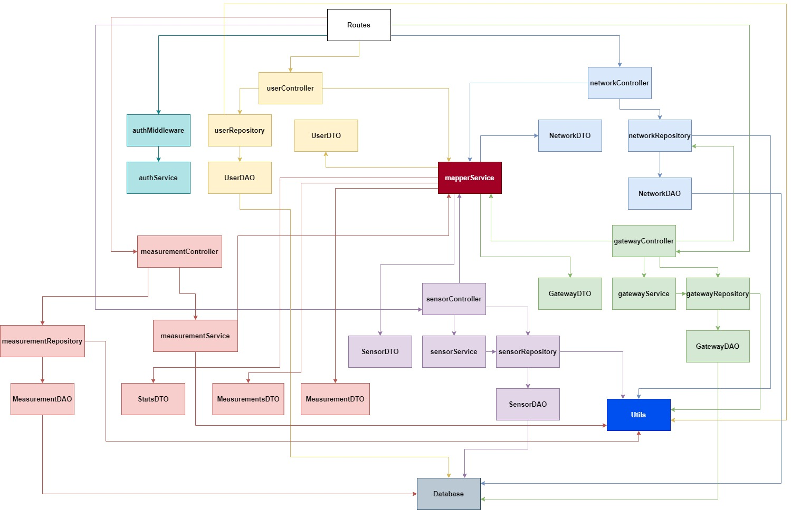
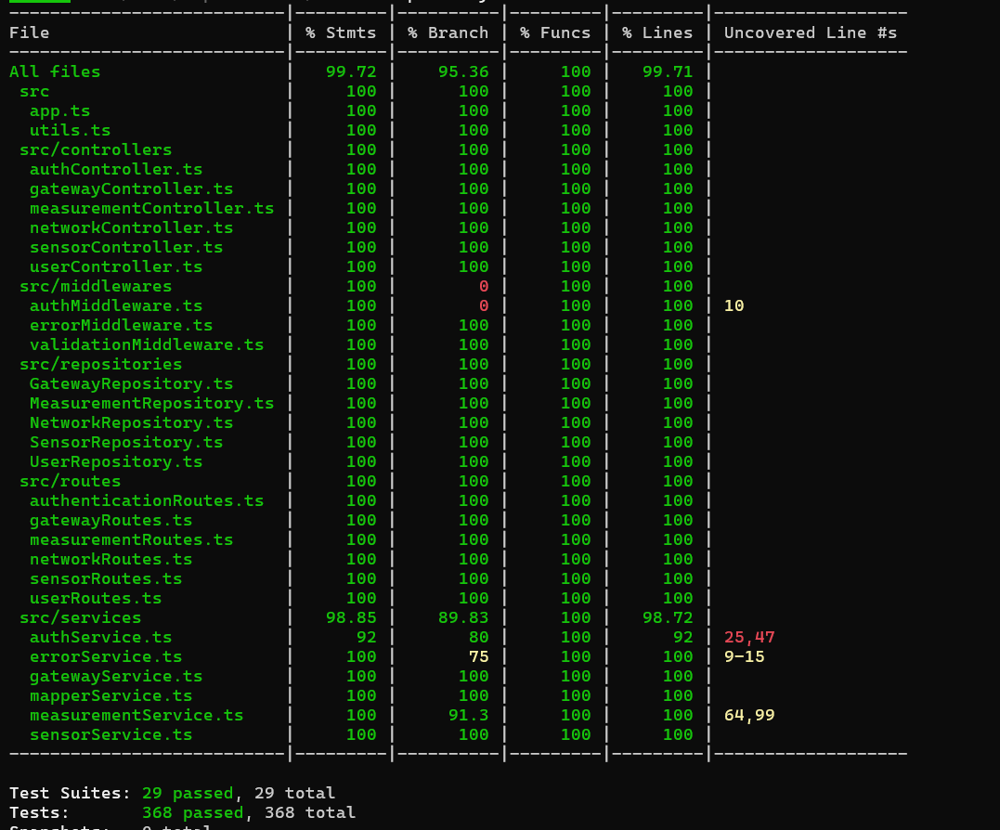

# Test Report

# Contents

- [Test Report](#test-report)
- [Contents](#contents)
- [Dependency graph](#dependency-graph)
- [Integration approach](#integration-approach)
- [Tests](#tests)
- [Coverage](#coverage)
  - [Coverage of FR](#coverage-of-fr)
  - [Coverage white box](#coverage-white-box)

# Dependency graph

  

# Integration approach

  L’approccio adottato per l’integrazione dei moduli del progetto è di tipo bottom-up, con una progressione graduale a partire dai componenti più vicini al database fino ai livelli superiori dell’architettura. Questo ha permesso di testare e validare singolarmente ciascun livello prima della loro combinazione in flussi più complessi.

  ## User Module

| **Step** | **Livello**         | **Componenti Coinvolti**                                        | **Tipo di test**             |
|----------|---------------------|------------------------------------------------------------------|------------------------------|
| 1        | Repository / DAO     | `UserRepository.ts` + `UserDAO.ts`                              |  Unit test                  |
| 2        | Service             | `authService.ts` + `mapperService.ts`                                   |  Integration test           |
| 3        | Controller          | `userController.ts`                                                 |  Integration test           |
| 4        | Routes              | `userRoutes.ts`                                                     |  Integration test           |
| 5        | API / E2E           | Percorso completo da `Routes` al `DB`                      |  API testing / End-to-End   |

  ## Network Module

| **Step** | **Livello**         | **Componenti Coinvolti**                                        | **Tipo di test**             |
|----------|---------------------|------------------------------------------------------------------|------------------------------|
| 1        | Repository / DAO     | `NetworkRepository.ts` + `NetworkDAO.ts`                              |  Unit test                  |
| 2        | Service             | `authService.ts` + `mapperService.ts`                          |  Integration test           |
| 3        | Controller          | `networkController.ts`                                                 |  Integration test           |
| 4        | Routes              | `networkRoutes.ts`                                                     |  Integration test           |
| 5        | API / E2E           | Percorso completo da `Routes` al `DB`                      |  API testing / End-to-End   |

  ## Gateway Module

| **Step** | **Livello**         | **Componenti Coinvolti**                                        | **Tipo di test**             |
|----------|---------------------|------------------------------------------------------------------|------------------------------|
| 1        | Repository / DAO     | `GatewayRepository.ts` + `GatewayDAO.ts`                              |  Unit test                  |
| 2        | Service             | `gatewayService.ts` + `authService.ts` + `mapperService.ts`             |  Integration test           |
| 3        | Controller          | `gatewayController.ts`                                                 |  Integration test           |
| 4        | Routes              | `gatewayRoutes.ts`                                                     |  Integration test           |
| 5        | API / E2E           | Percorso completo da `Routes` al `DB`                      |  API testing / End-to-End   |

  ## Sensor Module

| **Step** | **Livello**         | **Componenti Coinvolti**                                        | **Tipo di test**             |
|----------|---------------------|------------------------------------------------------------------|------------------------------|
| 1        | Repository / DAO     | `SensorRepository.ts` + `SensorDAO.ts`                              |  Unit test                  |
| 2        | Service             | `sensorService.ts` + `authService.ts` + `mapperService.ts`        |  Integration test           |
| 3        | Controller          | `sensorController.ts`                                                 |  Integration test           |
| 4        | Routes              | `sensorRoutes.ts`                                                     |  Integration test           |
| 5        | API / E2E           | Percorso completo da `Routes` al `DB`                      |  API testing / End-to-End   |

  ## Measurement Module

| **Step** | **Livello**         | **Componenti Coinvolti**                                        | **Tipo di test**             |
|----------|---------------------|------------------------------------------------------------------|------------------------------|
| 1        | Repository / DAO     | `MeasurementRepository.ts` + `MeasurementDAO.ts`                 |  Unit test                  |
| 2        | Service             | `measurementService.ts` + `authService.ts` + `mapperService.ts`     |  Integration test           |
| 3        | Controller          | `measurementController.ts`                                      |  Integration test           |
| 4        | Routes              | `measurementRoutes.ts`                                       |  Integration test           |
| 5        | API / E2E           | Percorso completo da `Routes` al `DB`                      |  API testing / End-to-End   |

# Tests

## User

| Test case name                                                                       | Object(s) tested            | Test level   | Technique used                                                                                         |
|-------------------------------------------------------------------------------------|-----------------------------|--------------|---------------------------------------------------------------------------------------------------|
| **UserRepository DB tests** - `createUser` - `getUserByUsername` (found/not) - conflict on duplicate  | `UserRepository`            | Unit/DB      | Equivalence partitioning (existent vs. non-existent users) Exception path (Conflict/NotFound)  |
| **UserController integration** - `getUser` mapping hides password                | `userController` + `UserRepository` mock | Integration   | White-box integration (controller→repo) DTO mapping verification                               |
| **UserRoutes integration** - GET `/users` (200/401/403) - token+rights checks | Express routes + `userController` mocks | Integration   | Authorization scenarios (Unauthorized/Forbidden) Error-path coverage (4xx)    Black-box                  |
| **User e2e tests** - POST `/auth` (200/500) - GET `/users` (200/401/403/500) - GET `/users/:username` (200/401/403/404) - DELETE `/users/:username` (204/401/403/404) - POST `/users` (201/401/403/409) | Full stack (app, controllers, real DB) | E2E     | Black-box end-to-end Authorization matrix Boundary/error-path coverage (4xx/5xx)             |
        

## Network

| Test case name                                                                                                                                                                                                                                                  | Object(s) tested                            | Test level  | Technique used                                                                                                       |
|-------------------------------------------------------------------------------------------------------------------------------------------------------------------------------------------------------------------------------------------------------------------|----------------------------------------------|-------------|--------------------------------------------------------------------------------------------------------------------------|
| **NetworkRepository Unit Tests:** - Creazione rete valida - Creazione duplicata (ConflictError) - Raccolta di tutte le reti - Ricerca rete inesistente (NotFoundError) - Cancellazione & aggiornamento rete, gestione input vuoti/duplicati             | `NetworkRepository`                         | Unit        | Equivalence partitioning (valid/invalid) Boundary-value (empty code) Exception path                                 |
| **NetworkController Integration Tests:** - getNetworkByCode → mapping DAO→DTO - getAllNetworks → mapping array - create/update/delete invocano il repository con i parametri giusti                                                                      | `networkController` + mocked `NetworkRepository` | Integration | Mock-based integration (verifica chiamate) Statement coverage                                                          |
| **NetworkRoutes Integration Tests:** - GET `/networks/:code`: 200/500/401 - GET `/networks`: 200/500/401 - POST `/networks`: 201/400/409/403/401 - PATCH `/networks/:code`: 204/400/404/409/403/401 - DELETE `/networks/:code`: 204/404/403/401           | Express routes + `authMiddleware` + mocked controller | Integration | Error path (4xx/5xx) Authorization scenarios Schema validation (bad input)    Black-box                                          |
| **Network E2E Tests:** - GET all networks: 200/401 - GET `/networks/:code`: 200/401/404 - POST rete: admin 201, operator 201, viewer 403, invalid token 401, missing campi 400, duplicato 409 - PATCH rete: admin/operator 204, viewer 403, invalid token 401, not found 404, dati invalidi 400, duplicato 409 - DELETE rete: admin/operator 204, viewer 403, invalid token 401, not found 404 | Full stack Express → DB → Auth               | E2E         | End-to-end flow Authorization coverage Boundary-value (duplicati, input invalidi) Equivalence partitioning    Black-box    |

## Gateway

| Test case name                                                                                                                                                                                                                                                                                                                                                                                              | Object(s) tested                                       | Test level   | Technique used                                                                                                       |
|---------------------------------------------------------------------------------------------------------------------------------------------------------------------------------------------------------------------------------------------------------------------------------------------------------------------------------------------------------------------------------------------------------------|---------------------------------------------------------|--------------|--------------------------------------------------------------------------------------------------------------------------|
| **GatewayRepository Unit Tests:** - create gateway - collects all gateways of a network - getGatewayByMacAddress not found (NotFoundError) - delete gateway                                                                                                                                                                                                                                       | `GatewayRepository`                                     | Unit         | Equivalence partitioning (valid/invalid MAC) Exception path                                                           |
| **GatewayController Integration Tests:** - getAllGateways → returns list - getGateway → mapping DAO→DTO (with sensors) - createGateway success & duplicate (ConflictError) - updateGateway success & conflict - deleteGateway                                                                                                                                                                       | `gatewayController` + real `GatewayRepository` & `NetworkRepository` | Integration   | White-box integration (service logic) Statement coverage                                                               |
| **GatewayRoutes Integration Tests:** - GET `/networks/:code/gateways/:mac`: 200/401/404/500 - GET `/networks/:code/gateways`: 200/401/404/500 - POST `/networks/:code/gateways`: 201/400/401/403/404/409/500 - PATCH `/networks/:code/gateways/:mac`: 204/400/401/403/404/409/500 - DELETE `/networks/:code/gateways/:mac`: 204/401/403/404                              | Express routes + `authMiddleware` + mocked controller    | Integration   | Error-path coverage (4xx/5xx) Authorization scenarios Schema validation (bad input)    Black-box                                  |
| **GatewayService Integration Tests:** - createGatewayService success & ConflictError - updateGatewayService success - update with undefined fields - update conflict                                                                                                                                                                                                                           | `gatewayService` + `GatewayRepository`                  | Integration   | Boundary-value (undefined fields) Exception path                                                                      |
| **Gateway E2E Tests:** - GET specific gateway: 200/401/404 - GET all gateways: 200/401/404 - POST gateway: 201/400/401/403/404/409/500 - PATCH gateway: 204/400/401/403/404/409/500 - DELETE gateway: 204/401/403/404                                                                                                                 | Full stack Express → DB → Auth                          | E2E          | End-to-end flows Authorization coverage Boundary-value & equivalence partitioning Exception handling        Black-box         |

## Sensor

| Test case name                                                                                                                                                                                                                                                                                                                                                               | Object(s) tested                    | Test level   | Technique used                                                                                               |
|------------------------------------------------------------------------------------------------------------------------------------------------------------------------------------------------------------------------------------------------------------------------------------------------------------------------------------------------------------------------------|-------------------------------------|--------------|---------------------------------------------------------------------------------------------------------------------|
| **SensorRepository Unit Tests:** - createSensor / duplicate MAC (ConflictError) - getSensorByMacAddress / not found (NotFoundError) - getAllSensors for gateway - deleteSensor / not found - updateSensor                                                                                                                                                 | `SensorRepository`                  | Unit         | Equivalence partitioning (valid/invalid MAC) Boundary-value (null vs. defined fields) Exception path           |
| **SensorController Integration Tests:** - getAllSensors → returns array - getAllSensors errors (network/gateway missing) - getSensor → returns DTO - getSensor errors (404) - createSensor → persists entity - createSensor errors (404/409) - updateSensor → modifies fields - updateSensor errors (404/409) - deleteSensor / errors               | `sensorController` + real repos     | Integration   | White-box integration (controller → repo calls) Statement coverage Exception flows                            |
| **SensorService Integration Tests:** - updateSensorService with new MAC/name/description - update with undefined fields (partial update) - update errors (404 all cases) - update conflict (duplicate MAC)                                                                                                                                                   | `sensorService` + `SensorRepository`| Integration   | Boundary-value (undefined fields) Exception path                                                                |
| **Sensor E2E Tests:** - GET `/networks/:n/gateways/:g/sensors` (200/401/404) - GET `/…/sensors/:s` (200/401/404) - POST `/…/sensors` (201/400/401/403/404/409) - DELETE `/…/sensors/:s` (204/401/403/404) - PATCH `/…/sensors/:s` (204/400/401/403/404/409)                                                                                             | Full stack Express → DB → Auth      | E2E          | End-to-end flow Authorization coverage Schema validation Error-path coverage (4xx/5xx) Equivalence partitioning     Black-box   |

## Measurement

| Test case name                                                                                                                                                                                                                                                                                                                                                                              | Object(s) tested                   | Test level   | Technique used                                                                                         |
|---------------------------------------------------------------------------------------------------------------------------------------------------------------------------------------------------------------------------------------------------------------------------------------------------------------------------------------------------------------------------------------------|------------------------------------|--------------|------------------------------------------------------------------------------------------------------------|
| **MeasurementRepository Integration Tests:** - `storeMeasurements`: save & retrieve - `getAllMeasurementsOfSensor`: not found entities - date‐range filters (start/end/both) - `getAllMeasurementsOfNetwork`: not found & retrieve all sensors - `storeMeasurements`: exception path (missing entities) - `getValidMacs`               | `MeasurementRepository`            | Integration   | Boundary‐value (date filters) Equivalence partitioning (valid/invalid codes/MACs) Exception path    |
| **MeasurementController Integration Tests:** - `storeMeasurements` via controller - `getAllMeasurementsOfSensor` & `getAllMeasurementsOfNetwork` - `getAllStatsOfSensor`/Network - `getAllOutliersOfSensor`/Network - error handling (NotFound, Internal) - date‐range parameters forwarding                                           | `measurementController` + real repos | Integration   | White‐box integration (controller→repo) Statement coverage Error‐path coverage (404/500) Boundary‐value (date) |
| **MeasurementRoutes Integration Tests:** - POST `/…/measurements` (201/400/404) - GET `/…/measurements` for sensor (200/400/401/404/500 + date‐filter) - GET `/…/stats` for sensor (200/400/404/500 + date‐filter) - GET `/…/outliers` for sensor (200/400/404/500 + date‐filter) - GET `/networks/:net/measurements/stats/outliers` (200/400/404/500) | Express routes + `measurementController` | Integration   | Error‐path coverage (4xx/5xx) Authorization scenarios Schema validation (bad input) Parameter forwarding    Black-box   |
| **MeasurementService Unit Tests:** - `getOutliers` logic - `parseDate` validation/BadRequestError - `computeStats` (mean/variance/thresholds) - `groupAndComputeMeasurements` (group & stats, empty/filter)                                                                                                                                                                   | `measurementService` functions      | Unit         | Equivalence partitioning (null vs. defined) Exception path (invalid date) Statistical boundary checks |
| **Measurement E2E Tests:** - GET `/networks/:net/gateways/:gat/sensors/:sens/measurements` (200/400/401/404/500 + date-filter) - GET `/networks/:net/measurements` (200/400/401/404/500 + date-filter) - POST `/networks/:net/gateways/:gat/sensors/:sens/measurements` (201/400/401/403/404/500) - GET `/networks/:net/stats` (200/400/401/404/500 + date-filter) - GET `/networks/:net/outliers` (200/400/401/404/500 + date-filter) - GET `/networks/:net/gateways/:gat/sensors/:sens/stats` (200/400/401/404/500 + date-filter) - GET `/networks/:net/gateways/:gat/sensors/:sens/outliers` (200/400/401/404/500 + date-filter) | Full stack Express → DB → Auth         | E2E          | End-to-end flows Authorization coverage  Boundary-value   Equivalence partitioning  Error-path coverage (4xx/5xx) Black-box   |

# Coverage

## Coverage of FR

| Functional Requirement                                   | Test(s) |
|----------------------------------------------------------------------|---------|
| **FR1: Authentication**                                              | <ul><li>`authRoutes: ok` (E2E auth)</li><li>`authRoutes: error` (E2E auth)</li></ul> |
| **FR1.1: Authenticate user**                                         | <ul><li>`authRoutes: ok`</li><li>`authRoutes: error`</li></ul> |
| **FR2.1: Retrieve all users**                                        | <ul><li>`get all users` (UserRoutes integration)</li><li>`get all users: 401 UnauthorizedError`</li><li>`get all users: 403 InsufficientRightsError`</li><li>`get all users: 500 Error` (User.e2e)</li></ul> |
| **FR2.2: Create a new user**                                         | <ul><li>`create a new user` (UserRoutes integration)</li><li>`create a new user: 401 unauthorized`</li><li>`create a new user: 403 InsufficientRightsError`</li><li>`create a new user: 409 ConflictError`</li></ul> |
| **FR2.3: Retrieve a specific user**                                  | <ul><li>`get User: mapperService integration` (Controller)</li><li>`get a specfic user` (User.e2e)</li><li>`get a specific user: 401 unauthorized`</li><li>`get a specific user: 403 InsufficientRightsError`</li><li>`get a specific user: 404 NotFoundError`</li></ul> |
| **FR2.4: Delete a specific user**                                    | <ul><li>`delete a specfic user` (User.e2e)</li><li>`delete a user: 401 unauthorized`</li><li>`delete a user: 403 InsufficientRightsError`</li><li>`delete a user: 404 NotFoundError`</li></ul> |
| **FR3.1: Retrieve all networks**                                     | <ul><li>`collects all networks` (NetworkRepository.db.test.ts)</li><li>`get All Networks: mapperService integration` (NetworkController.integration.test.ts)</li><li>`get all networks` (NetworkRoutes.integration.test.ts)</li><li>`get all networks` (Network.e2e.test.ts)</li></ul> |
| **FR3.2: Retrieve a network by code**                                | <ul><li>`throws NotFoundError when network is not found` (NetworkRepository.db.test.ts)</li><li>`get Network: mapperService integration` (NetworkController.integration.test.ts)</li><li>`get network by code` (NetworkRoutes.integration.test.ts)</li><li>`get network by code` (Network.e2e.test.ts)</li></ul> |
| **FR3.3: Create a new network**                                      | <ul><li>`create network` (NetworkRepository.db.test.ts)</li><li>`create New Network` (NetworkController.integration.test.ts)</li><li>`create network` (NetworkRoutes.integration.test.ts)</li><li>`create network` (Network.e2e.test.ts)</li></ul> |
| **FR3.4: Update an existing network**                                | <ul><li>`updates a network` (NetworkRepository.db.test.ts)</li><li>`update Network` (NetworkController.integration.test.ts)</li><li>`update network` (NetworkRoutes.integration.test.ts)</li></ul> |
| **FR3.5: Delete a network**                                          | <ul><li>`deletes a gateway` (NetworkRepository.db.test.ts)</li><li>`delete Network` (NetworkController.integration.test.ts)</li><li>`delete network` (NetworkRoutes.integration.test.ts)</li></ul> |
| **FR4.1: Retrieve all gateways of a network**                        | <ul><li>`collects all the gateways of a network` (GatewayRepository.db.test.ts)</li><li>`get all gateways of a network` (GatewayController.integration.test.ts)</li><li>`get all gateways of a network` (GatewayRoutes.integration.test.ts)</li><li>`get all gateways of a specific network` (Gateway.e2e.test.ts)</li></ul> |
| **FR4.2: Retrieve a gateway by MAC**                                 | <ul><li>`throws NotFoundError when gateway is not found` (GatewayRepository.db.test.ts)</li><li>`get gateway` (GatewayController.integration.test.ts)</li><li>`get a specific gateway` (GatewayRoutes.integration.test.ts)</li><li>`get a specific gateway` (Gateway.e2e.test.ts)</li></ul> |
| **FR4.3: Create a new gateway**                                      | <ul><li>`create gateway` (GatewayRepository.db.test.ts)</li><li>`createGateway successfull` (GatewayController.integration.test.ts)</li><li>`create a new gateway` (GatewayRoutes.integration.test.ts)</li><li>`create a gateway` (Gateway.e2e.test.ts)</li></ul> |
| **FR4.4: Update an existing gateway**                                | <ul><li>`update successfull` (GatewayController.integration.test.ts)</li><li>`update an existing gateway: 204` (GatewayRoutes.integration.test.ts)</li><li>`update gateway` (Gateway.e2e.test.ts)</li></ul> |
| **FR4.5: Delete a gateway**                                          | <ul><li>`delete a gateway` (GatewayRepository.db.test.ts)</li><li>`delete` (GatewayController.integration.test.ts)</li><li>`delete a gateway: 204 OK` (GatewayRoutes.integration.test.ts)</li></ul> |
| **FR5.1: Retrieve all sensors of a gateway**                         | <ul><li>`getAllSensors should return all sensors for a gateway` (SensorRepository.db.test.ts)</li><li>`get all sensors` (SensorController.integration.test.ts)</li><li>`GET …/sensors` (Sensor.e2e.test.ts)</li></ul> |
| **FR5.2: Create a new sensor for a gateway**                         | <ul><li>`createSensor should insert a sensor` (SensorRepository.db.test.ts)</li><li>`create sensor` (SensorController.integration.test.ts)</li><li>`create sensor` (Sensor.e2e.test.ts)</li></ul> |
| **FR5.3: Retrieve a specific sensor**                                | <ul><li>`getSensorByMacAddress should return sensor` (SensorRepository.db.test.ts)</li><li>`get sensor` (SensorController.integration.test.ts)</li><li>`GET …/sensors/{SENS}` (Sensor.e2e.test.ts)</li></ul> |
| **FR5.4: Update a specific sensor**                                  | <ul><li>`updateSensor should update sensor data` (SensorRepository.db.test.ts)</li><li>`update sensor` (SensorController.integration.test.ts)</li><li>`PATCH …/sensors/{SENS}` (Sensor.e2e.test.ts)</li></ul> |
| **FR5.5: Delete a specific sensor**                                  | <ul><li>`deleteSensor should remove a sensor` (SensorRepository.db.test.ts)</li><li>`delete sensor` (SensorController.integration.test.ts)</li><li>`DELETE …/sensors/{SENS}` (Sensor.e2e.test.ts)</li></ul> |
| **FR6.1: Retrieve measurements for a set of sensors of a network**    | <ul><li>`getAllMeasurementsOfNetwork should retrieve all sensors' data` (MeasurementRepository.db.test.ts)</li><li>`get all measurements of network` (MeasurementController.integration.test.ts)</li><li>`GET /networks/:networkCode/measurements` (MeasurementRoutes.integration.test.ts)</li></ul> |
| **FR6.2: Retrieve statistics for a set of sensors of a network**      | <ul><li>`get all stats of network` (MeasurementController.integration.test.ts)</li><li>`GET /networks/:networkCode/stats` (MeasurementRoutes.integration.test.ts)</li><li>`groupAndComputeMeasurements: tutto ok` (MeasurementService.integration.test.ts)</li></ul> |
| **FR6.3: Retrieve outliers for a set of sensors of a network**       | <ul><li>`get all outliers of network` (MeasurementController.integration.test.ts)</li><li>`GET /networks/:networkCode/outliers` (MeasurementRoutes.integration.test.ts)</li></ul> |
| **FR6.4: Store measurements for a specific sensor**                  | <ul><li>`storeMeasurements should save and retrieve measurements` (MeasurementRepository.db.test.ts)</li><li>`store and retrieve measurements for sensor` (MeasurementController.integration.test.ts)</li><li>`store measurements: 201 Created` (MeasurementRoutes.integration.test.ts)</li></ul> |
| **FR6.5: Retrieve measurements for a specific sensor**               | <ul><li>`getAllMeasurementsOfSensor should filter by date range` (MeasurementRepository.db.test.ts)</li><li>`store and retrieve measurements for sensor` (MeasurementController.integration.test.ts)</li><li>`GET …/sensors/{SENS}/measurements` (MeasurementRoutes.integration.test.ts)</li></ul> |
| **FR6.6: Retrieve statistics for a specific sensor**                 | <ul><li>`get stats of sensor` (MeasurementController.integration.test.ts)</li><li>`GET …/sensors/{SENS}/stats` (MeasurementRoutes.integration.test.ts)</li><li>`computeStats: all ok` (MeasurementService.integration.test.ts)</li></ul> |
| **FR6.7: Retrieve outliers for a specific sensor**                   | <ul><li>`get outliers of sensor` (MeasurementController.integration.test.ts)</li><li>`GET …/sensors/{SENS}/outliers` (MeasurementRoutes.integration.test.ts)</li><li>`getOutliers: risultato corretto` (MeasurementService.integration.test.ts)</li></ul> |

## Coverage white box

  